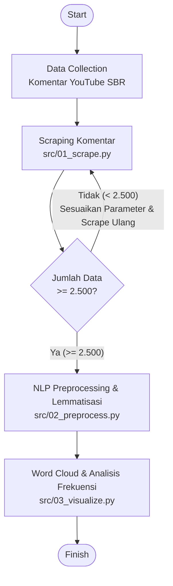
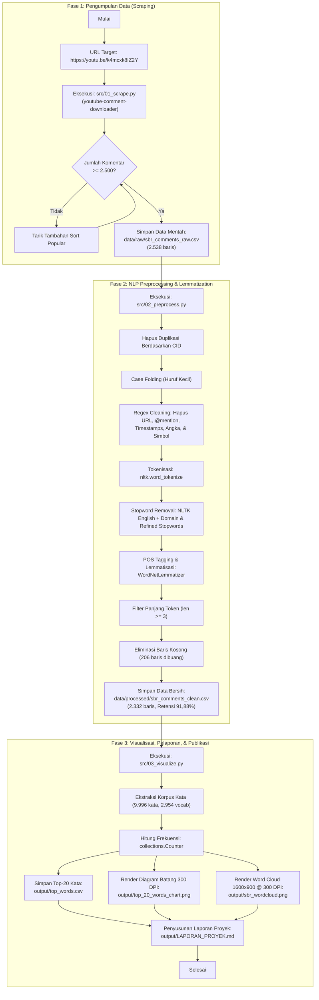

# Steel Ball Run Trailer - Text Mining & Word Cloud Pipeline

Proyek ini merupakan pipeline *end-to-end* Text Mining dan analisis persepsi publik berbasis Word Cloud terhadap trailer resmi **STEEL BALL RUN JoJo’s Bizarre Adventure | Official Trailer | Netflix** (`https://youtu.be/k4mcxk8IZ2Y`).

## Diagram Alir Pipeline (Flowchart)

### 1. Alur Ringkas & Logika Loop (Quick Flowchart)


### 2. Alur Detail (Detailed Flowchart)



> Diagram alir grafis resolusi tinggi (300 DPI) juga tersedia di berkas [output/pipeline_flowchart.png](output/pipeline_flowchart.png).

---

## Struktur Direktori
```text
.
├── data/
│   ├── raw/                      # Data mentah hasil scraping (sbr_comments_raw.csv - 2.538 baris)
│   └── processed/                # Data bersih setelah NLP preprocessing (sbr_comments_clean.csv - 2.332 baris)
├── output/
│   ├── pipeline_flowchart.png    # Diagram alir visual resolusi tinggi (300 DPI)
│   ├── sbr_wordcloud.png         # Visualisasi Word Cloud resolusi tinggi (1600x900 @ 300 DPI)
│   ├── top_20_words_chart.png    # Grafik batang Top-20 kata (300 DPI)
│   ├── top_words.csv             # Tabel frekuensi Top-20 kata sesudah kurasi stopwords
│   ├── top_words_before.csv      # Tabel frekuensi Top-20 kata sebelum kurasi stopwords
│   └── LAPORAN_PROYEK.md         # Laporan akademik lengkap (Ilham Ramadhani - 2411102441066)
├── src/
│   ├── 01_scrape.py              # Modul scraper komentar YouTube
│   ├── 02_preprocess.py          # Modul pembersihan & preprocessing teks NLP
│   ├── 03_visualize.py           # Modul pembuatan Word Cloud & analisis frekuensi
│   ├── generate_flowchart.py     # Generator diagram alir visual beresolusi tinggi
│   └── main.py                   # Master pipeline orchestrator
├── requirements.txt              # Daftar dependensi pustaka Python
├── .gitignore                    # Konfigurasi pengabaian file venv & cache
└── README.md
```

## Setup & Instalasi
1. Pastikan Python 3.10+ terinstal.
2. Buat virtual environment dan pasang dependensi:
   ```bash
   python -m venv .venv
   # Windows PowerShell:
   .venv\Scripts\Activate.ps1
   pip install -r requirements.txt
   ```

## Menjalankan Pipeline
Jalankan seluruh pipeline dari awal hingga akhir:
```bash
python src/main.py --target 3000
```
Atau jalankan per modul secara terpisah:
```bash
# 1. Scraping komentar mentah
python src/01_scrape.py --limit 3000

# 2. Preprocessing & Lemmatization
python src/02_preprocess.py

# 3. Visualisasi Word Cloud & Top-20 Words
python src/03_visualize.py

# 4. Generate visual flowchart
python src/generate_flowchart.py
```
