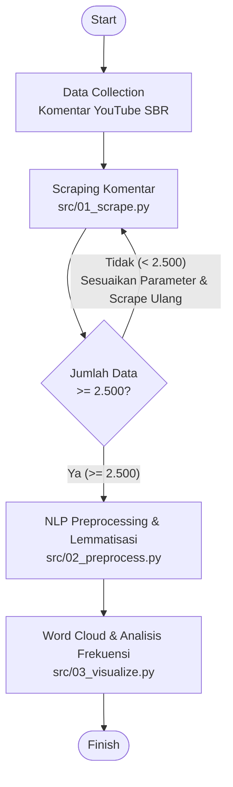

# LAPORAN PROYEK TEXT MINING DAN ANALISIS SENTIMEN WORD CLOUD
## Analisis Persepsi dan Respons Publik terhadap Trailer Resmi JoJo’s Bizarre Adventure: Steel Ball Run pada Platform YouTube

**Disusun Oleh:**  
- **Nama:** Ilham Ramadhani  
- **Mata Kuliah:** Machine Learning & Big Data  
- **Program Studi:** Teknik Informatika  

---

## BAB 1: PENDAHULUAN

### 1.1 Latar Belakang
Perkembangan industri hiburan animasi Jepang (*anime*) telah menjangkau audiens global dalam skala masif. Salah satu waralaba paling berpengaruh secara kultural adalah *JoJo’s Bizarre Adventure* karya Hirohiko Araki. Bagian ketujuh dari seri ini, yaitu *Steel Ball Run* (SBR), secara luas dianggap oleh para kritikus dan pembaca manga sebagai salah satu karya fiksi bergambar terbaik sepanjang masa, menempati peringkat teratas dalam berbagai basis data komunitas global seperti MyAnimeList.

Peluncuran trailer resmi perdana *STEEL BALL RUN JoJo’s Bizarre Adventure | Official Trailer | Netflix* pada platform YouTube (`https://youtu.be/k4mcxk8IZ2Y`) memicu gelombang respons yang sangat besar dari komunitas internasional. Kolom komentar video tersebut menjadi wadah interaksi terbuka yang memuat ekspresi emosional, kritik terhadap aspek teknis produksi, perdebatan strategi penayangan, hingga ekspektasi terhadap pengisi suara (*voice acting*).

Data tekstual tak terstruktur (*unstructured text*) dalam jumlah ribuan komentar ini menyimpan wawasan berharga yang sulit diekstraksi secara manual. Oleh karena itu, pendekatan *Text Mining* dan *Natural Language Processing* (NLP) diperlukan untuk mengolah, menyaring, dan mengekstraksi informasi substantif dari komentar publik. Teknik visualisasi *Word Cloud* berbasis frekuensi kata terdistribusi dan lemmatisasi morfologis menjadi sarana yang efektif untuk menyajikan pola dominan opini publik secara komprehensif.

### 1.2 Tujuan Proyek
Tujuan dari pelaksanaan proyek penambangan teks ini adalah:
1. Membangun dan mengimplementasikan pipeline penambangan teks (*end-to-end Text Mining pipeline*) secara modular menggunakan bahasa pemrograman Python.
2. Mengumpulkan dataset komentar publik berskala besar (target 2.500 hingga 3.000 data) dari video trailer resmi *Steel Ball Run* di YouTube.
3. Melakukan tahapan prapemrosesan teks (*NLP text preprocessing*) bahasa Inggris yang mencakup *case folding*, pembersihan derau (*regex cleaning*), tokenisasi, eliminasi *stopwords* umum dan domain, serta lemmatisasi berbasis *Part-of-Speech* (POS) *tagging*.
4. Menganalisis frekuensi kata dominan serta merender representasi visual *Word Cloud* resolusi tinggi (1600x900 piksel, 300 DPI) untuk mengidentifikasi topik-topik sentral respons penggemar.
5. Mengkaji opini publik ke dalam klasifikasi tematik, seperti strategi rilis platform, kualitas sulih suara, penokohan, dan antusiasme komunitas.

---

## BAB 2: METODOLOGI PENELITIAN

### 2.1 Alur Ringkas Pipeline & Logika Validasi (Flowchart Singkat)
Diagram berikut menggambarkan alur kerja utama secara ringkas beserta percabangan validasi batas kuantitas data:

### 2.2 Diagram Alir Detail Pipeline (Detailed Flowchart)
Arsitektur modular pipeline penambangan teks terbagi menjadi tahapan-tahapan teknis terperinci sebagai berikut:

> **Catatan:** Diagram alir versi visual resolusi tinggi (300 DPI) juga tersedia pada berkas [output/pipeline_flowchart.png](file:///c:/Users/Administrator/Documents/SEMESTER%205/B%20Machine%20Learning%20&%20Big%20Data/Data%20Mining/output/pipeline_flowchart.png).

### 2.3 Pengumpulan Data (*Data Collection & Scraping*)
Pengumpulan data primer dilakukan secara terprogram memanfaatkan modul `youtube-comment-downloader`. Skrip pengikis (`src/01_scrape.py`) dirancang untuk mengambil korpus komentar tanpa membutuhkan kuota token YouTube Data API v3 yang terbatas. Atribut data mentah yang diekstraksi mencakup:
- Pengenal komentar unik (`cid`)
- Teks komentar asli (`text`)
- Waktu unggah relatif (`time`)
- Nama pengguna/penulis (`author`)
- Jumlah dukungan/upvote (`votes`)

Dataset disimpan dalam format CSV dengan pengkodean karakter `utf-8-sig` pada direktori `data/raw/sbr_comments_raw.csv`.

### 2.4 Prapemrosesan Teks (*Text Preprocessing*)
Dataset komentar media sosial memiliki tingkat derau (*noise*) yang sangat tinggi, meliputi penggunaan bahasa gaul, singkatan, emoji, tanda baca berlebih, dan tautan luar. Skrip `src/02_preprocess.py` menerapkan standar pemrosesan teks bahasa Inggris sebagai berikut:

1. **Penghapusan Duplikasi:** Memfilter rekaman dengan `cid` atau isi teks yang identik untuk menjamin integritas data unik.
2. **Case Folding:** Mengonversi seluruh teks ke huruf kecil (*lowercase*) guna memastikan keseragaman representasi string.
3. **Pembersihan Berbasis Regex (*Regex Cleaning*):**
   - Menghapus tautan web (`https?://\S+|www\.\S+`).
   - Menghapus mention pengguna (`@\w+`).
   - Menghapus penanda waktu video (*timestamps*, contoh: `01:23`, `2:45`).
   - Menghapus karakter khusus, angka (`\d+`), dan entitas HTML (`&\w+;`).
   - Menghapus emoji dan karakter non-ASCII melalui normalisasi ASCII.
4. **Tokenisasi (*Tokenization*):** Memecah untaian kalimat menjadi token kata individual menggunakan `nltk.tokenize.word_tokenize`.
5. **Eliminasi Stopwords (*Stopword Removal*):**
   - Menggunakan daftar bawaan NLTK English Stopwords (seperti `the`, `is`, `at`, `which`).
   - Menambahkan *domain stopwords* dan kata umum video (seperti `jojo`, `bizarre`, `adventure`, `trailer`, `netflix`, `anime`, `video`, `watch`, `watching`, `part`).
   - Menerapkan *iterative refinement* untuk menyaring kata generik/filler non-informatif (seperti `like`, `get`, `one`, `really`, `even`, `still`, `make`, `go`, `see`, `know`).
6. **Lemmatisasi Berbasis POS (*Part-of-Speech Lemmatization*):**
   Menggunakan `WordNetLemmatizer` yang dipadukan dengan `nltk.pos_tag` untuk mengembalikan setiap kata ke bentuk leksikal dasarnya secara akurat berdasarkan fungsi gramatikanya (kata kerja, kata benda, kata sifat, atau kata keterangan).
7. **Penyaringan Panjang Kata (*Length Filtering*):**
   Menghapus token yang memiliki panjang kurang dari 3 huruf (`len(word) >= 3`) pasca-lemmatisasi untuk membuang artefak fragmen tanda baca.

Data bersih hasil prapemrosesan disimpan pada direktori `data/processed/sbr_comments_clean.csv`.

### 2.5 Visualisasi dan Ekstraksi Frekuensi
Skrip `src/03_visualize.py` mengeksekusi perhitungan distribusi frekuensi kata menggunakan struktur data `collections.Counter`. Selanjutnya dihasilkan dua luaran utama:
1. **Tabel Frekuensi Top-20 Kata (`output/top_words.csv`):** Menyajikan peringkat 20 kata kunci paling signifikan.
2. **Word Cloud Resolusi Tinggi (`output/sbr_wordcloud.png`):** Dibuat menggunakan pustaka `wordcloud` dengan konfigurasi kanvas 1600x900 piksel, kerapatan 300 DPI, latar belakang putih, palet warna *viridis*, dan parameter `collocations=False` untuk mencegah redudansi pasangan kata ganda.
3. **Diagram Batang Frekuensi (`output/top_20_words_chart.png`):** Visualisasi pendukung berupa diagram horizontal guna memperlihatkan disparitas kuantitatif antar-kata kunci.

---

## BAB 3: HASIL DAN PEMBAHASAN

### 3.1 Statistik Hasil Pengumpulan dan Prapemrosesan Data
Proses ekstraksi data berhasil mengumpulkan sebanyak 2.538 komentar publik. Seluruh proses prapemrosesan berhasil menyaring derau teks secara efektif dengan mempertahankan persentase data valid sebesar 91,88%. Rincian ringkasan metrik statistik disajikan pada tabel berikut:

| Parameter Metrik | Kuantitas | Keterangan |
| :--- | :---: | :--- |
| **Total Komentar Mentah (Raw)** | **2.538** | Memenuhi target minimal proyek (2.500 baris) |
| Komentar Duplikat Dihapus | 0 | Seluruh entri komentar awal berstatus unik |
| Komentar Non-Huruf / Kosong Dieliminasi | 206 | Berisi hanya emoji, simbol, atau derau tanpa arti |
| **Total Komentar Bersih (Clean)** | **2.332** | Data valid siap analisis teks |
| **Tingkat Retensi Data Valid** | **91,88%** | Integritas data terpelihara dengan sangat baik |
| **Total Korpus Kata Bersih** | **9.996** | Akumulasi seluruh token kata hasil lemmatisasi |
| **Ukuran Kosakata Unik (Vocabulary)** | **2.954** | Jumlah kata leksikal unik berbeda |

### 3.2 Evaluasi dan Perbandingan Stopwords (Sebelum vs Sesudah Refinement)
Pada tahap evaluasi awal sebelum penyempurnaan *custom stopwords*, visualisasi frekuensi masih memuat kata-kata generik percakapan bahasa Inggris seperti `good`, `first`, `gon`, `weeky`, `bad`, `cant`, dan `year`. Kata-kata tersebut belum memberikan wawasan spesifik terhadap konten anime *Steel Ball Run*.

Berikut adalah tabel komparasi 20 kata teratas sebelum dan sesudah proses pembersihan leksikal lanjutan:

| No | Kata Awal (Sebelum Refinement) | Frekuensi | Kata Terkurasi (Sesudah Refinement) | Frekuensi | Relevansi Kontekstual |
| :-: | :--- | :-: | :--- | :-: | :--- |
| 1 | weekly | 215 | **weekly** | 215 | Model rilis episode mingguan |
| 2 | dub | 198 | **dub** | 198 | Aspek sulih suara bahasa Inggris |
| 3 | wait | 154 | **wait** | 154 | Penantian rilis adaptasi anime |
| 4 | release | 144 | **release** | 144 | Jadwal dan strategi peluncuran |
| 5 | voice | 107 | **voice** | 107 | Penilaian performa aktor suara |
| 6 | good *(generik)* | 107 | **peak** | 106 | Istilah apresiasi kualitas ("peak fiction") |
| 7 | peak | 105 | **batch** | 103 | Penolakan rilis serentak (*batch drop*) |
| 8 | batch | 103 | **sound** | 88 | Efek suara dan tata suara trailer |
| 9 | sound | 88 | **gyro** | 83 | Protagonis utama: Gyro Zeppeli |
| 10 | gyro | 83 | **johnny** | 77 | Protagonis utama: Johnny Joestar |
| 11 | johnny | 78 | **price** | 66 | Merujuk nama Stand & pengisi suara |
| 12 | first *(generik)* | 66 | **act** | 63 | Fase stand (*Tusk Acts*) & aksi naratif |
| 13 | price | 66 | **english** | 57 | Bahasa sulih suara pada trailer |
| 14 | gon *(slang)* | 66 | **horse** | 48 | Elemen balap kuda lintas benua |
| 15 | weeky *(typo)* | 65 | **accent** | 47 | Aksen bicara karakter (Italia/Barat) |
| 16 | bad *(generik)* | 64 | **diego** | 46 | Karakter antagonis: Diego Brando |
| 17 | cant *(kontraksi)* | 63 | **sub** | 46 | Preferensi audio orisinal (*subbed*) |
| 18 | act | 63 | **love** | 45 | Sentimen afektif positif penonton |
| 19 | year *(generik)* | 60 | **stage** | 45 | Tahapan rute perlombaan (*race stages*) |
| 20 | english | 57 | **filthy** | 43 | Rujukan Stand *Filthy Acts* (D4C) |

Pembersihan iteratif ini berhasil menaikkan kata-kata yang sarat konteks (*horse*, *accent*, *diego*, *sub*, *love*, *stage*, dan *filthy*) ke dalam jajaran 20 kata kunci dominan.

### 3.3 Analisis Tematik Temuan Data

Berdasarkan 20 kata kunci teratas sesudah prapemrosesan terkurasi, opini publik terbagi menjadi empat pilar tematik utama:

#### 1. Perdebatan Model Distribusi dan Penayangan (`weekly` vs `batch`, `release`, `wait`)
Kata `weekly` (215 kemunculan) menempati peringkat pertama, berpasangan secara kontras dengan kata `batch` (103 kemunculan). Hal ini merefleksikan resistensi kuat dari komunitas global terhadap strategi rilis *batch* (merilis belasan episode sekaligus) yang diterapkan Netflix pada seri sebelumnya (*Stone Ocean*). Penggemar secara vokal menuntut penayangan berkala satu episode per minggu (*weekly release*) guna menjaga momentum diskusi, pembangunan teori cerita, dan antusiasme komunitas di media sosial.

#### 2. Kualitas Produksi Suara dan Lokalisasi (`dub`, `voice`, `sound`, `english`, `accent`, `sub`)
Kemunculan kata `dub` (198), `voice` (107), `sound` (88), `english` (57), `accent` (47), dan `sub` (46) menunjukkan bahwa perhatian utama pemirsa pada trailer resmi ini tertuju pada aspek audio. Cuplikan trailer yang menyajikan dialog dalam bahasa Inggris memantik perdebatan hangat mengenai kecocokan intonasi dan aksen geografis karakter, khususnya aksen Italia dari tokoh Gyro Zeppeli dan aksen Amerika dari Johnny Joestar.

#### 3. Penokohan dan Elemen Khas Cerita (*Lore*) (`gyro`, `johnny`, `diego`, `horse`, `stage`, `price`, `filthy`, `act`)
Data menunjukkan pengenalan mendalam audiens terhadap materi manga aslinya:
- Karakter utama **Gyro** (83) dan **Johnny** (77) serta rival utama **Diego** (46) menjadi poros perbincangan.
- Kata **horse** (48) dan **stage** (45) menyoroti premis sentral *Steel Ball Run* yang berlatar perlombaan pacuan kuda lintas benua Amerika Serikat pada akhir abad ke-19 yang dibagi menjadi 9 tahapan (*stages*).
- Kata **filthy** (43), **act** (63), dan **price** (66) mengindikasikan lelucon internal (*meme*) dan antisipasi terhadap lokalisasi nama kemampuan supranatural Stand *Dirty Deeds Done Dirt Cheap* (D4C) milik Funny Valentine yang dalam versi bahasa Inggris resmi diubah menjadi *"Filthy Acts at a Reasonable Price"*, serta merujuk pada nama pengisi suara veteran Jamieson Price.

#### 4. Valuasi Kualitas dan Afeksi Penggemar (`peak`, `love`, `wait`)
Kata **peak** (106 kemunculan) dan **love** (45 kemunculan) membuktikan sentimen positif yang sangat dominan. Frasa kultural internet *"peak fiction"* digunakan secara luas oleh warganet untuk menegaskan bahwa bagian *Steel Ball Run* adalah mahakarya naratif yang paling dinantikan visualisasinya.

### 3.4 Visualisasi Representasi Kata
Visualisasi *Word Cloud* resolusi tinggi (1600x900 piksel pada kerapatan 300 DPI) telah dihasilkan pada berkas:
- **Lokasi Berkas Word Cloud:** `output/sbr_wordcloud.png`
- **Lokasi Berkas Grafik Batang:** `output/top_20_words_chart.png`

Pada representasi grafis tersebut, ukuran tipografi kata `weekly`, `dub`, `wait`, `release`, `voice`, `peak`, dan `batch` tampak mendominasi ruang visual utama, mempertegas keselarasan antara distribusi numerik tabel frekuensi dengan hierarki visual grafik.

---

## BAB 4: KESIMPULAN

Pelaksanaan proyek penambangan teks pada dataset komentar trailer *JoJo’s Bizarre Adventure: Steel Ball Run* di platform YouTube berhasil dieksekusi secara tuntas melalui pipeline otomatis yang teruji:

1. **Efektivitas Pipeline:** Seluruh modul skrip (`01_scrape.py`, `02_preprocess.py`, `03_visualize.py`, dan `main.py`) bekerja secara berkesinambungan dan berhasil mengekstrak 2.538 komentar publik mentah serta memfilter 2.332 rekaman komentar bersih berkualitas tinggi (retensi 91,88%).
2. **Kualitas Prapemrosesan:** Penerapan pembersihan bertahap menggunakan NLTK Stopwords yang digabungkan dengan eliminasi *domain stopwords* serta lemmatisasi berbasis *Part-of-Speech Tagging* terbukti krusial dalam menyingkirkan derau leksikal, sehingga kata-kata yang muncul pada representasi akhir mencerminkan wawasan tematik yang bernilai analitis tinggi.
3. **Wawasan Utama Publik:** Respons komunitas terhadap trailer *Steel Ball Run* didominasi oleh dua isu utama: tuntutan model penayangan mingguan (*weekly episodic release*) untuk menggantikan sistem *batch*, serta evaluasi mendalam terhadap kualitas sulih suara bahasa Inggris (*dubbing & voice accents*). Sentimen keseluruhan ditandai oleh antusiasme luar biasa dari audiens yang menilai adaptasi karya ini sebagai puncak kualitas waralaba (*peak*).

