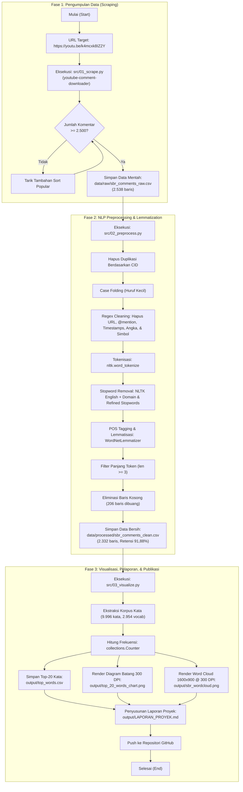
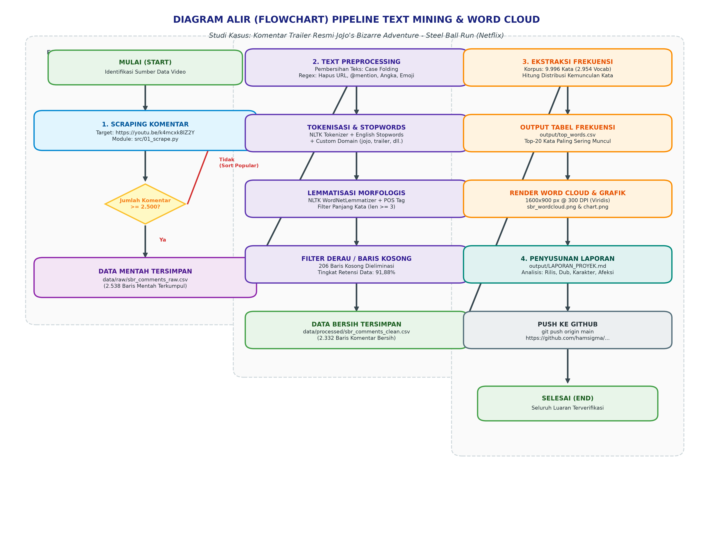
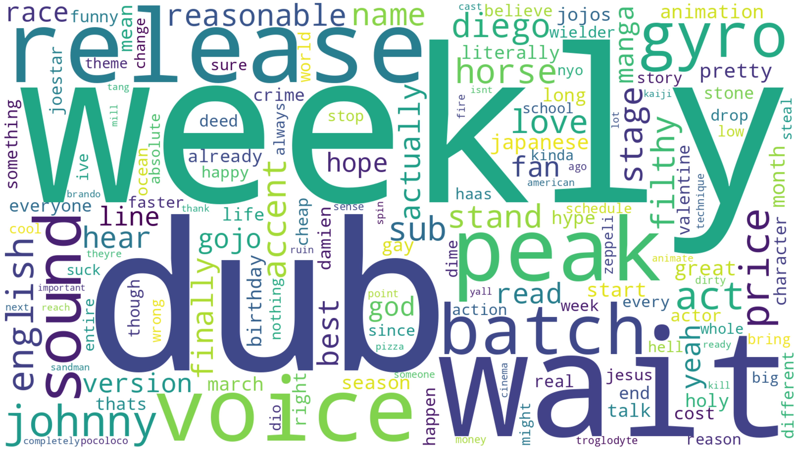
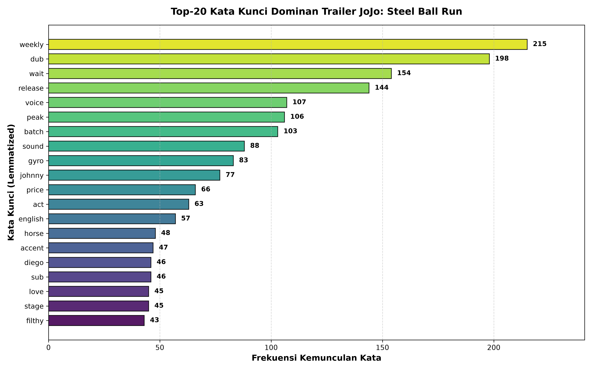

# LAPORAN PROYEK TEXT MINING DAN ANALISIS SENTIMEN WORD CLOUD
## Analisis Persepsi dan Respons Publik terhadap Trailer Resmi JoJo’s Bizarre Adventure: Steel Ball Run pada Platform YouTube

**Disusun Oleh:**  
- **Nama:** Ilham Ramadhani  
- **NIM:** 2411102441066  
- **Mata Kuliah:** Data Mining / Machine Learning & Big Data  
- **Program Studi:** Teknik Informatika  

---

## DAFTAR ISI

- [BAB 1: PENDAHULUAN](#bab-1-pendahuluan)
  - [1.1 Latar Belakang](#11-latar-belakang)
  - [1.2 Tujuan](#12-tujuan)
  - [1.3 Batasan Masalah](#13-batasan-masalah)
- [BAB 2: LANDASAN TEORI](#bab-2-landasan-teori)
  - [2.1 Text Mining](#21-text-mining)
  - [2.2 Data Collection](#22-data-collection)
  - [2.3 Scraping](#23-scraping)
  - [2.4 NLP Preprocessing](#24-nlp-preprocessing)
  - [2.5 Word Cloud](#25-word-cloud)
  - [2.6 Flowchart Singkat](#26-flowchart-singkat)
  - [2.7 Flowchart Detail](#27-flowchart-detail)
- [BAB 3: SUMBER DATA](#bab-3-sumber-data)
  - [3.1 Sumber Data](#31-sumber-data)
  - [3.2 Deskripsi Atribut Data](#32-deskripsi-atribut-data)
  - [3.3 Kriteria dan Volume Data](#33-kriteria-dan-volume-data)
- [BAB 4: LANGKAH TEXT MINING DAN PROSESNYA](#bab-4-langkah-text-mining-dan-prosesnya)
  - [4.1 Tahap 1: Pengumpulan Data dan Scraping](#41-tahap-1-pengumpulan-data-dan-scraping)
  - [4.2 Tahap 2: Prapemrosesan Teks (NLP Preprocessing)](#42-tahap-2-prapemrosesan-teks-nlp-preprocessing)
  - [4.3 Tahap 3: Analisis Frekuensi dan Visualisasi Word Cloud](#43-tahap-3-analisis-frekuensi-dan-visualisasi-word-cloud)
  - [4.4 Tahap 4: Pembahasan Tematik dan Temuan Wawasan](#44-tahap-4-pembahasan-tematik-dan-temuan-wawasan)
- [BAB 5: KESIMPULAN DAN SARAN](#bab-5-kesimpulan-dan-saran)
  - [5.1 Kesimpulan](#51-kesimpulan)
  - [5.2 Saran](#52-saran)

---

## BAB 1: PENDAHULUAN

### 1.1 Latar Belakang
Perkembangan industri animasi Jepang (*anime*) telah menjelma menjadi fenomena budaya global dengan basis penggemar yang sangat militan dan vokal. Salah satu waralaba paling legendaris dan berpengaruh adalah *JoJo’s Bizarre Adventure* karya Hirohiko Araki, di mana bagian ketujuhnya, yaitu *Steel Ball Run* (SBR), secara luas diakui oleh para kritikus maupun komunitas internasional sebagai salah satu mahakarya naratif terbaik sepanjang masa. Ketika trailer resmi perdananya bertajuk *STEEL BALL RUN JoJo’s Bizarre Adventure | Official Trailer | Netflix* dirilis pada platform YouTube melalui tautan `https://youtu.be/k4mcxk8IZ2Y`, kolom komentar langsung dibanjiri ribuan respons publik. Kolom komentar tersebut menjadi sarana interaksi terbuka yang memuat spektrum opini yang sangat luas, mulai dari antusiasme emosional, perdebatan tajam terkait strategi penayangan mingguan (*weekly*) versus rilis sekaligus (*batch*), evaluasi aksen dan kualitas sulih suara bahasa Inggris (*voice acting*), hingga antisipasi terhadap elemen cerita legendaris seperti pacuan kuda lintas benua dan pertarungan kekuatan *Stand*.

Pengerjaan proyek ini didorong oleh motivasi akademis untuk mempelajari dan mengetahui secara langsung bagaimana teknik *Text Mining* (penambangan teks) beserta seluruh tahapan prosesnya diimplementasikan secara sistematis pada data dunia nyata (*real-world unstructured data*). Ribuan komentar publik di YouTube merupakan data tekstual mentah yang sangat bising, sarat akan bahasa gaul (*slang*), singkatan, emoji, tanda baca berlebih, dan derau linguistik lainnya yang mustahil dianalisis secara manual dengan akurat. Melalui integrasi metodologi penambangan teks dan pemrosesan bahasa alami (*Natural Language Processing* / NLP)—mulai dari pengumpulan data (*scraping*), pembersihan data (*preprocessing* & lemmatisasi leksikal), hingga penyajian visual berbasis *Word Cloud* dan analisis frekuensi—proyek ini bertujuan untuk membongkar pola-pola terselubung dan mengabstraksikan wawasan kunci respons masyarakat terhadap trailer *Steel Ball Run* secara objektif, ilmiah, dan terukur.

### 1.2 Tujuan
Tujuan dari pelaksanaan proyek penambangan teks ini adalah:
1. Mempelajari, merancang, dan mengimplementasikan arsitektur *end-to-end Text Mining pipeline* berbasis bahasa pemrograman Python secara modular dan otomatis.
2. Mengumpulkan dataset komentar publik berskala besar (target minimal 2.500 hingga 3.000 rekaman) dari trailer YouTube *Steel Ball Run*.
3. Menerapkan metodologi prapemrosesan teks (*NLP text preprocessing*) bahasa Inggris yang mencakup *case folding*, eliminasi derau dengan ekspresi reguler (*regex*), tokenisasi kata, penyaringan kata henti (*stopwords*) berbasis domain terkurasi, serta normalisasi morfologis menggunakan lemmatisasi *Part-of-Speech* (POS) *tagging*.
4. Mengembangkan visualisasi *Word Cloud* beresolusi tinggi (1600x900 piksel, 300 DPI) dan mengekstraksi peringkat Top-20 kata dominan guna memetakan topik sentral secara intuitif.
5. Mengkaji dan mengklasifikasikan respons publik ke dalam beberapa pilar tematik utama, seperti model penayangan, kualitas lokalisasi audio, pengenalan narasi, dan valuasi afektif penggemar.

### 1.3 Batasan Masalah
Agar pembahasan tetap terarah dan fokus pada sasaran penelitian, batasan masalah yang ditetapkan adalah:
1. **Sumber Data:** Korpus komentar diambil secara eksklusif dari satu video resmi YouTube, yaitu *STEEL BALL RUN JoJo’s Bizarre Adventure | Official Trailer | Netflix* dengan identitas video `k4mcxk8IZ2Y`.
2. **Kuantitas Data:** Target pengumpulan data berkisar antara minimal 2.500 hingga 3.000 komentar publik teratas pada saat pengambilan data dilakukan.
3. **Bahasa:** Pemrosesan bahasa alami difokuskan pada teks berbahasa Inggris (*English NLP*), mengingat audiens trailer resmi ini didominasi oleh komunitas internasional.
4. **Cakupan Analisis:** Analisis dibatasi pada penambangan teks frekuensi kata leksikal, kurasi *stopwords*, dan visualisasi distribusi (*Word Cloud* & diagram batang horizontal), tanpa mencakup pemodelan klasifikasi sentimen berbasis *machine learning/deep learning* (seperti BERT atau LSTM).

---

## BAB 2: LANDASAN TEORI

### 2.1 Text Mining
*Text Mining* (disebut juga *Text Data Mining* atau *Knowledge Discovery from Text*) adalah proses penemuan dan ekstraksi pola, tren, dan wawasan yang bernilai dari data tekstual tak terstruktur (*unstructured text*). Berbeda dengan penambangan data tradisional yang beroperasi pada tabel basis data terstruktur, *Text Mining* menangani kompleksitas bahasa manusia yang memiliki ambiguitas semantik, variasi morfologis, serta format penulisan bebas. Dalam praktiknya, penambangan teks menggabungkan konsep kecerdasan buatan, linguistik komputasional, statistika, dan temu balik informasi (*information retrieval*).

### 2.2 Data Collection
*Data Collection* (pengumpulan data) merupakan fondasi pertama dalam siklus hidup sains data. Pada ranah digital, pengumpulan data teks umumnya dilakukan dari antarmuka web, media sosial, atau repositori dokumen. Kualitas dan representativitas data yang dikumpulkan pada tahap ini sangat menentukan validitas hasil analisis pada tahapan selanjutnya (*garbage in, garbage out*).

### 2.3 Scraping
*Web Scraping* adalah teknik ekstraksi data terprogram dari halaman web atau platform daring secara otomatis. Pada platform media sosial seperti YouTube, pengikisan data komentar dapat dilakukan melalui antarmuka resmi (YouTube Data API v3) atau melalui modul pengikis khusus seperti `youtube-comment-downloader`. Penggunaan teknik pengikis pihak ketiga memungkinkan pengambilan korpus dalam jumlah ribuan tanpa terkendala batasan kuota token harian yang ketat pada API resmi.

### 2.4 NLP Preprocessing
*Natural Language Processing* (NLP) *Preprocessing* adalah rangkaian proses standardisasi dan penyaringan teks mentah menjadi format token bersih yang siap diproses secara statistik. Tahapan prapemrosesan mencakup:
1. **Case Folding:** Mengubah seluruh karakter ke dalam huruf kecil (*lowercase*) agar representasi kata seragam (contoh: `"Johnny"` dan `"johnny"` dihitung sebagai kata yang sama).
2. **Regex Cleaning (Pembersihan Derau):** Penggunaan pola *Regular Expressions* (Regex) untuk menyaring komponen teks tak relevan seperti tautan situs web (`http\S+|www\S+`), penanda akun (`@\w+`), penanda waktu video (*timestamps*), angka numerik (`\d+`), emoji, dan simbol karakter non-alfabet.
3. **Tokenisasi (Tokenization):** Proses pemecahan untaian kalimat menjadi unit leksikal terkecil berupa potongan kata individual (*tokens*).
4. **Stopword Removal (Penyaringan Kata Henti):** Mengeliminasi kata-kata fungsional yang memiliki frekuensi kemunculan sangat tinggi namun minim kontribusi semantik (seperti kata sambung dan kata ganti: *the*, *is*, *in*, *which*). Pada konteks khusus, diperlukan kurasi *domain stopwords* (seperti kata *video*, *trailer*, *watch*) agar topik utama dapat terlihat tajam.
5. **Lemmatisasi (Lemmatization) Berbasis POS Tagging:** Berbeda dengan *stemming* yang memotong imbuhan secara kasar berdasarkan aturan pemotongan (*rule-based heuristic*), lemmatisasi memanfaatkan kamus morfologis leksikal (seperti *WordNet*) dan kelas kata (*Part-of-Speech* / POS Tagging) untuk mengembalikan suatu kata ke bentuk dasarnya yang valid secara kamus (contoh: kata kerja `"running"` menjadi `"run"`, `"crying"` menjadi `"cry"`).

### 2.5 Word Cloud
*Word Cloud* (atau *tag cloud*) adalah representasi visual grafis dari data teks di mana tingkat kepentingan dan frekuensi kemunculan setiap kata dicerminkan secara proporsional melalui ukuran tipografi (font) dan ketebalan kata. Kata yang paling sering muncul dalam korpus akan dirender dengan ukuran paling besar dan diletakkan pada posisi sentral kanvas visual. Teknik ini sangat efektif untuk memberikan gambaran cepat mengenai topik dominan tanpa mengharuskan pembaca menelusuri ribuan baris teks satu per satu.

### 2.6 Flowchart Singkat
Diagram alir singkat berikut memperlihatkan alur kerja utama proyek beserta logika percabangan validasi kuota data:

### 2.7 Flowchart Detail
Arsitektur modular menyeluruh yang memperlihatkan dekomposisi tiap fase teknis dan berkas luaran data:

> **Catatan:** Versi gambar resolusi tinggi dari diagram alir detail (300 DPI) disajikan pada Gambar 2.1 berikut:

#### Gambar 2.1 Diagram Alir Detail Pipeline Text Mining

---

## BAB 3: SUMBER DATA

### 3.1 Sumber Data
Dataset penelitian ini diperoleh langsung dari platform video YouTube pada trailer resmi anime *Steel Ball Run*. Spesifikasi sumber data adalah sebagai berikut:
- **Judul Video:** STEEL BALL RUN JoJo’s Bizarre Adventure | Official Trailer | Netflix
- **URL Video:** `https://youtu.be/k4mcxk8IZ2Y`
- **Penerbit / Saluran:** Akun Resmi Netflix Anime
- **Karakteristik Data:** Komentar publik terbuka dari warganet global, didominasi percakapan bahasa Inggris informal, kaya akan istilah khusus (*fandom jargon*), dan memuat respons spontan terhadap cuplikan animasi perdana.

### 3.2 Deskripsi Atribut Data
Data mentah yang diekstraksi dari platform YouTube disimpan dalam format tabular dengan skema kolom sebagai berikut:

| Nama Kolom | Tipe Data | Deskripsi / Penjelasan |
| :--- | :--- | :--- |
| `cid` | String (Alfanumerik) | *Comment Identifier* unik yang diterbitkan oleh sistem YouTube untuk setiap entri komentar. |
| `text` | String (Teks) | Isi teks komentar yang dituliskan oleh pengguna (data mentah tak terstruktur). |
| `time` | String | Waktu relatif pengunggahan komentar pada saat pengikisan data dilakukan (contoh: *"2 days ago"*). |
| `author` | String | Nama akun / *handle* pengguna YouTube yang mengunggah komentar. |
| `votes` | Integer | Jumlah dukungan (*upvotes/likes*) yang diperoleh komentar dari warganet lain. |
| `photo` | String (URL) | Tautan foto profil pengguna pengunggah komentar. |
| `heart` | Boolean | Status penandaan *love/heart* dari pengunggah video resmi terhadap komentar. |
| `reply` | Boolean | Penanda apakah komentar tersebut merupakan balasan (*reply thread*) atau komentar utama. |

### 3.3 Kriteria dan Volume Data
Berdasarkan aturan proyek, jumlah minimum data yang wajib dihimpun adalah 2.500 hingga 3.000 komentar. Pada realisasi penarikan data, skrip pengikis berhasil mengunduh **2.538 baris komentar publik mentah** tanpa ada baris duplikat, sehingga kriteria kuantitatif data berhasil dipenuhi sepenuhnya.

---

## BAB 4: LANGKAH TEXT MINING DAN PROSESNYA

### 4.1 Tahap 1: Pengumpulan Data dan Scraping
Proses pengumpulan data diimplementasikan pada skrip modular [src/01_scrape.py](file:///c:/Users/Administrator/Documents/SEMESTER%205/B%20Machine%20Learning%20&%20Big%20Data/Data%20Mining/src/01_scrape.py) memanfaatkan pustaka `youtube-comment-downloader`. 

- **Mekanisme Eksekusi:** Modul menginisialisasi generator stream pengikisan berdasarkan urutan waktu terbaru (`SORT_BY_RECENT`).
- **Verifikasi Batas Kuantitas:** Skrip secara dinamis memverifikasi apakah batas kuota 2.500 data terpenuhi. Jika data urutan terbaru di bawah ambang batas, skrip secara otomatis melakukan penarikan tambahan pada segmen komentar terpopuler (`SORT_BY_POPULAR`) dengan mekanisme deduplikasi `cid`.
- **Luaran:** Menghasilkan berkas `data/raw/sbr_comments_raw.csv` dengan total **2.538 baris** data mentah.

### 4.2 Tahap 2: Prapemrosesan Teks (NLP Preprocessing)
Pembersihan teks diimplementasikan pada modul [src/02_preprocess.py](file:///c:/Users/Administrator/Documents/SEMESTER%205/B%20Machine%20Learning%20&%20Big%20Data/Data%20Mining/src/02_preprocess.py). Tahapan pembersihan dieksekusi secara berurutan:

1. **Pemeriksaan Duplikasi:** Pengecekan kolom `cid` memastikan 2.538 entri awal berstatus unik (0 duplikat).
2. **Case Folding:** Transformasi teks menjadi huruf kecil (*lowercase*).
3. **Pembersihan Regex:**
   - Menghapus tautan web (`https?://\S+|www\.\S+`).
   - Menghapus mention pengguna (`@\w+`).
   - Menghapus penanda waktu video (*timestamps*, misal `01:23`, `2:45`).
   - Menghapus angka dan entitas HTML (`&\w+;`, `\\[nrt]`).
   - Menghapus emoji dan karakter non-ASCII.
   - Menghapus tanda baca dan simbol non-huruf (`[^a-zA-Z\s]`).
4. **Tokenisasi:** Pemecahan teks menjadi token menggunakan `nltk.tokenize.word_tokenize`.
5. **Kurasi Stopwords Bertahap:**
   - Menggabungkan daftar baku `nltk.corpus.stopwords.words("english")`.
   - Mengeliminasi kata domain umum: `jojo`, `bizarre`, `adventure`, `trailer`, `netflix`, `anime`, `video`, `watch`, `watching`, `part`, `steel`, `ball`, `run`, `sbr`, `episode`.
   - Mengeliminasi kata percakapan generik bahasa Inggris: `like`, `get`, `one`, `really`, `even`, `still`, `make`, `go`, `see`, `know`, `think`, `look`, `time`, `people`, `thing`, `say`, `tell`, `come`, `take`, `give`, `back`, `much`, `way`, `day`, `never`, `ever`, `well`, `want`, `need`, `let`, `call`, `show`, `man`, `bro`, `guy`, `yes`, `please`, `would`, `could`, `also`, `first`, `year`, `good`, `bad`, `new`.
   - Mengeliminasi kata slang/kontraksi: `gon`, `gonna`, `cant`, `dont`, `wont`, `didnt`, `aint`, `weeky`.
6. **POS Tagging & Lemmatisasi Morfologis:** Memetakan tag pohon Penn Treebank ke format *WordNet* (`wordnet.VERB`, `wordnet.NOUN`, `wordnet.ADJ`, `wordnet.ADV`) agar proses lematisasi menghasilkan kata dasar yang tepat.
7. **Filter Panjang Karakter:** Menyaring token dengan panjang minimal 3 karakter (`len(word) >= 3`).

#### Statistik Hasil Prapemrosesan Data:
| Parameter Metrik | Nilai | Keterangan |
| :--- | :---: | :--- |
| Jumlah Baris Mentah (Raw) | 2.538 | Data awal hasil scraping |
| Baris Duplikat Dihapus | 0 | Seluruh data awal berstatus unik |
| Baris Kosong / Non-Huruf Dieliminasi | 206 | Berisi hanya emoji/simbol tanpa kata valid |
| **Jumlah Baris Bersih Akhir (Clean)** | **2.332** | Data valid yang berhasil diselamatkan |
| **Tingkat Retensi Data Valid** | **91,88%** | Integritas data terpelihara dengan sangat tinggi |
| **Total Kata dalam Korpus Bersih** | **9.996** | Total token pasca-lemmatisasi |
| **Ukuran Kosakata Unik (Vocabulary)** | **2.954** | Jumlah kata unik berbeda |

#### Evaluasi Komparasi Stopwords (Sebelum vs Sesudah Refinement):
Penyempurnaan daftar kata henti terbukti signifikan dalam membuang derau percakapan umum dan mengangkat kata kunci substansial ke jajaran Top-20 kata:

| No | Kata Awal (Sebelum Refinement) | Frekuensi | Kata Terkurasi (Sesudah Refinement) | Frekuensi | Relevansi Konteks Anime SBR |
| :-: | :--- | :-: | :--- | :-: | :--- |
| 1 | weekly | 215 | **weekly** | 215 | Model rilis episode mingguan yang dituntut penonton |
| 2 | dub | 198 | **dub** | 198 | Perbincangan sulih suara bahasa Inggris |
| 3 | wait | 154 | **wait** | 154 | Penantian rilis adaptasi anime SBR |
| 4 | release | 144 | **release** | 144 | Jadwal dan strategi penayangan resmi |
| 5 | voice | 107 | **voice** | 107 | Penilaian performa aktor suara |
| 6 | good *(generik)* | 107 | **peak** | 106 | Apresiasi kualitas cerita (*"peak fiction"*) |
| 7 | peak | 105 | **batch** | 103 | Penolakan sistem rilis sekaligus (*batch drop*) |
| 8 | batch | 103 | **sound** | 88 | Efek suara dan tata musik pada trailer |
| 9 | sound | 88 | **gyro** | 83 | Protagonis utama: Gyro Zeppeli |
| 10 | gyro | 83 | **johnny** | 77 | Protagonis utama: Johnny Joestar |
| 11 | johnny | 78 | **price** | 66 | Nama Stand resmi & nama pengisi suara Jamieson Price |
| 12 | first *(generik)* | 66 | **act** | 63 | Fase kekuatan Stand (*Tusk Acts*) & aksi naratif |
| 13 | price | 66 | **english** | 57 | Bahasa audio yang disorot pada trailer |
| 14 | gon *(slang)* | 66 | **horse** | 48 | Premis pacuan kuda lintas benua Amerika |
| 15 | weeky *(typo)* | 65 | **accent** | 47 | Diskusi aksen suara karakter (Italia / Amerika) |
| 16 | bad *(generik)* | 64 | **diego** | 46 | Karakter antagonis: Diego Brando |
| 17 | cant *(kontraksi)* | 63 | **sub** | 46 | Preferensi audio orisinal Jepang dengan takarir (*sub*) |
| 18 | act | 63 | **love** | 45 | Ekspresi sentimen afektif positif komunitas |
| 19 | year *(generik)* | 60 | **stage** | 45 | Pembagian tahapan rute lomba (*race stages*) |
| 20 | english | 57 | **filthy** | 43 | Lokalisasi nama Stand *Filthy Acts* (D4C) |

### 4.3 Tahap 3: Analisis Frekuensi dan Visualisasi Word Cloud
Visualisasi dieksekusi melalui modul [src/03_visualize.py](file:///c:/Users/Administrator/Documents/SEMESTER%205/B%20Machine%20Learning%20&%20Big%20Data/Data%20Mining/src/03_visualize.py):
1. **Penyimpanan Tabel Frekuensi:** Data Top-20 kata dominan disimpan dalam berkas `output/top_words.csv`.
2. **Generasi Word Cloud Resolusi Tinggi:** Menggunakan parameter dimensi 1600x900 piksel, palet warna *viridis*, batas maksimal 150 kata, dan opsi `collocations=False` untuk mencegah duplikasi pasangan kata. Dihasilkan berkas `output/sbr_wordcloud.png` dengan kerapatan cetak 300 DPI.
3. **Diagram Batang Horizontal:** Visualisasi kuantitatif frekuensi kata yang dilengkapi label angka presisi pada berkas `output/top_20_words_chart.png` (300 DPI).

#### Gambar 4.1 Visualisasi Word Cloud Komentar Trailer Steel Ball Run (1600x900 px, 300 DPI)

#### Gambar 4.2 Diagram Batang Frekuensi Top-20 Kata Kunci Dominan (300 DPI)

### 4.4 Tahap 4: Pembahasan Tematik dan Temuan Wawasan
Berdasarkan kata-kata dominan yang berhasil diekstraksi, terdapat 4 pilar tematik utama yang mencerminkan psikologi dan persepsi publik:

1. **Perdebatan Model Distribusi dan Penayangan (`weekly` vs `batch`, `release`, `wait`):**  
   Kata `weekly` (215 kali) menduduki peringkat teratas dan berpasangan secara kontras dengan kata `batch` (103 kali). Fenomena ini memperlihatkan resistensi kuat dari komunitas global terhadap strategi rilis serentak (*batch drop*) yang sebelumnya diterapkan Netflix pada seri *Stone Ocean*. Penggemar menyuarakan desakan kuat agar *Steel Ball Run* ditayangkan satu episode per minggu (*weekly release*) demi menjaga atmosfer diskusi mingguan di media sosial.
2. **Kualitas Produksi Suara dan Lokalisasi Audio (`dub`, `voice`, `sound`, `english`, `accent`, `sub`):**  
   Kemunculan kata `dub` (198), `voice` (107), `sound` (88), `english` (57), `accent` (47), dan `sub` (46) mengindikasikan bahwa perhatian utama pemirsa pada trailer resmi ini tertuju pada aspek audio. Penggunaan dialog bahasa Inggris memantik evaluasi mendalam mengenai aksen karakter utama, terutama aksen Italia Gyro Zeppeli dan aksen Amerika Johnny Joestar.
3. **Penokohan dan Elemen Cerita (*Lore*) (`gyro`, `johnny`, `diego`, `horse`, `stage`, `filthy`, `price`, `act`):**  
   Munculnya nama karakter utama Gyro (83), Johnny (77), dan Diego (46) menunjukkan kelekatan penonton terhadap narasi cerita. Kata `horse` (48) dan `stage` (45) merefleksikan premis perlombaan pacuan kuda 9 tahapan yang menjadi inti cerita. Sedangkan kata `filthy` (43), `act` (63), dan `price` (66) merujuk pada lokalisasi nama kemampuan supranatural Stand Funny Valentine (*"Filthy Acts at a Reasonable Price"* / D4C) serta aktor pengisi suara veteran Jamieson Price.
4. **Sentimen Afektif dan Antusiasme Kualitas (`peak`, `love`, `wait`):**  
   Dominasi kata `peak` (106 kali) dan `love` (45 kali) membuktikan sentimen positif yang sangat kental. Istilah kultural internet *"peak fiction"* digunakan secara masif oleh warganet untuk menegaskan bahwa *Steel Ball Run* merupakan mahakarya yang telah lama mereka nantikan penayangannya.

---

## BAB 5: KESIMPULAN DAN SARAN

### 5.1 Kesimpulan
Berdasarkan rangkaian proses penambangan teks yang telah dilaksanakan pada 2.538 komentar trailer resmi *JoJo’s Bizarre Adventure: Steel Ball Run*, dapat diambil kesimpulan sebagai berikut:
1. **Keberhasilan Pipeline Modular:** Pipeline *Text Mining* yang dibangun menggunakan Python (terdiri atas modul pengikis `01_scrape.py`, prapemrosesan `02_preprocess.py`, visualisasi `03_visualize.py`, dan *orchestrator* `main.py`) berhasil beroperasi secara tangguh dengan tingkat retensi data valid sebesar 91,88% (2.332 baris data bersih).
2. **Peran Kritis Kurasi Stopwords:** Penerapan lemmatisasi morfologis berbasis POS Tagging yang dipadukan dengan kurasi *stopwords* domain terbukti mutlak diperlukan untuk menyingkirkan derau leksikal percakapan umum, sehingga kata-kata yang dipertahankan memiliki bobot informasi kontekstual yang tajam.
3. **Peta Aspirasi Komunitas:** Analisis frekuensi dan *Word Cloud* membuktikan bahwa fokus utama penggemar tertuju pada penolakan sistem rilis *batch* dan tuntutan rilis mingguan (*weekly*), evaluasi aksen sulih suara bahasa Inggris (*dub*), serta antusiasme yang sangat tinggi (*peak*) terhadap visualisasi petualangan pacuan kuda Gyro Zeppeli dan Johnny Joestar.

### 5.2 Saran
Untuk pengembangan dan penelitian lanjutan di masa mendatang, beberapa saran yang dapat diajukan antara lain:
1. **Analisis Sentimen Otomatis:** Mengembangkan pemodelan analisis sentimen otomatis berbasis leksikon (VADER) atau model berbasis Transformer (seperti RoBERTa atau DistilBERT) untuk mengklasifikasikan polaritas sentimen (positif, netral, negatif) secara otomatis pada tingkat kalimat.
2. **Pemodelan Topik (Topic Modeling):** Menerapkan algoritma *Latent Dirichlet Allocation* (LDA) atau BERTopic untuk mengekstraksi klaster topik secara matematis tanpa bergantung pada frekuensi kata tunggal.
3. **Perluasan Sumber Korpus:** Mengintegrasikan korpus komentar dari platform media sosial lain (seperti X/Twitter dan Reddit) untuk memperoleh perbandingan opini lintas platform yang lebih heterogen.
